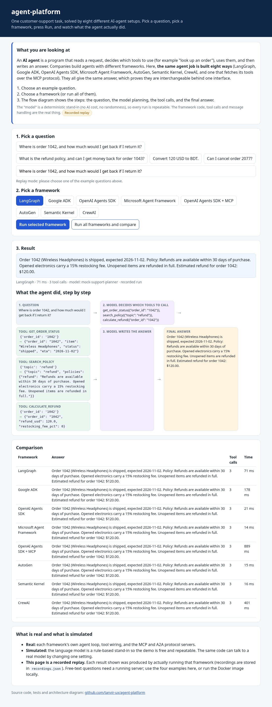
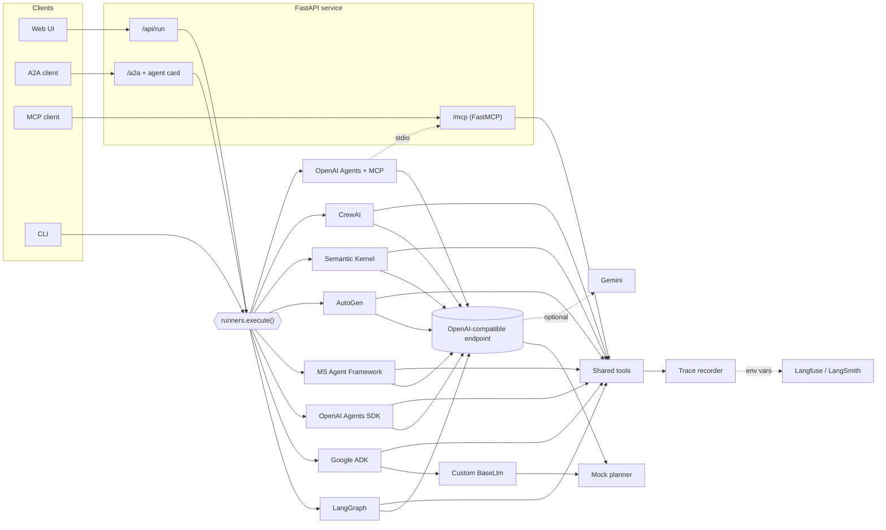

**▶ Live demo (no login, click and run): https://tanvir-ux.github.io/agent-platform/**

# agent-platform

One customer-support task, implemented **eight ways** with the major agent frameworks, behind a single interface. It is served through a FastAPI service that also exposes the tools as an **MCP server** and the agent as an **A2A (Agent2Agent) agent**, with Langfuse and LangSmith tracing hooks.

[](https://github.com/tanvir-ux/agent-platform/actions/workflows/ci.yml)




## What this demonstrates

| Area | What is in the repository |
| --- | --- |
| Agent frameworks | LangGraph (explicit `StateGraph`), Google ADK, OpenAI Agents SDK, Microsoft Agent Framework, AutoGen, Semantic Kernel, CrewAI, plus a variant of the OpenAI Agents SDK that fetches its tools over MCP |
| Protocols | FastMCP server (stdio and streamable HTTP at `/mcp/`), A2A agent card and JSON-RPC endpoint (`/a2a`) built on `a2a-sdk` |
| Service | FastAPI app with REST endpoints, OpenAPI docs at `/docs`, a rate-limited optional live-LLM mode, and a no-login web UI |
| Testability | A deterministic, OpenAI-compatible mock LLM, so all frameworks run in CI without API keys |
| Observability | An in-process trace recorder (drives the UI), plus Langfuse and LangSmith wrappers that switch on from environment variables |

## Architecture



The tools (`get_order_status`, `search_policy`, `calculate_refund`, `convert_currency`) are plain Python functions. Each framework wraps them natively, and FastMCP exposes the same functions. Every framework talks to one OpenAI-compatible endpoint, which is the mock planner by default. Google ADK uses a custom `BaseLlm` that calls the same planner, so the mock needs no network there.

## What ran live and what did not

This table is the honest status of the repository as published. "Mock model" means the deterministic planner in `mockllm.py`, not a real LLM.

| Item | Status |
| --- | --- |
| All 8 agent setups, full agent loop and tool calls, against the mock model | **Executed**: 54 tests pass (main environment, 7 setups) plus 36 in the CrewAI environment; recorded outputs are in the demo |
| FastAPI endpoints, web UI served by FastAPI | **Executed** (tests, plus a headless-browser click-through) |
| A2A agent card and `SendMessage` round trip | **Executed** locally against the in-process server (tests, plus an `a2a-sdk` client) |
| MCP server (in-memory client, HTTP at `/mcp/`, stdio consumed by the OpenAI Agents SDK) | **Executed** locally |
| Live LLM (Gemini `gemini-3.1-flash-lite`, free tier) | **Partly executed.** Only the OpenAI Agents SDK completed a live run. LangGraph, Microsoft Agent Framework and AutoGen returned HTTP 400 from Google's OpenAI-compatible endpoint (probably the Gemini 3 thought-signature requirement); Semantic Kernel hit a quota error and Google ADK a 503. Details: [`docs/demo/live-gemini.txt`](docs/demo/live-gemini.txt). The other frameworks are mock-verified only |
| Langfuse and LangSmith hooks | **Unit-tested with fake SDKs only.** Never sent to the hosted services |
| Hosted demo on GitHub Pages | **Recorded replay** of real runs (see below). It is not a live backend |
| Docker image | **Executed in GitHub Actions**: the CI job builds the image, starts it and checks `/api/health` and a `/api/run` call |
| Hugging Face Space publish script (`deploy/huggingface`) | **Written but not executed** (no Hugging Face token was available when this was built) |

## The hosted demo

The page linked on the first line is static. Each result you see was produced by actually running that framework against the mock model, and the recordings are stored in [`src/agent_platform/web/recordings.json`](src/agent_platform/web/recordings.json) (regenerate with `python scripts/record.py`). Only the four example questions can be replayed. Run the service yourself (below) and the same page switches to **Live server** mode, where you can type any question.

## Quick start

Python 3.12 is required.

```bash
git clone https://github.com/tanvir-ux/agent-platform && cd agent-platform
python -m venv .venv && source .venv/bin/activate
pip install -r requirements-frameworks.txt   # pinned versions
pip install --no-deps -e .

agent-platform list                           # frameworks installed here
agent-platform run all "Where is order 1042, and how much would I get back if I return it?"
agent-platform serve                          # UI at http://127.0.0.1:8000, docs at /docs
agent-platform mcp                            # MCP server over stdio
```

CrewAI pins an older FastMCP and conflicts with the main set, so it lives in its own environment:

```bash
pip install -r requirements-crewai.txt && pip install --no-deps -e .
```

Or use Docker (the image contains every framework except CrewAI):

```bash
docker build -t agent-platform . && docker run -p 7860:7860 agent-platform
```

### Using the protocols

```bash
curl localhost:8000/.well-known/agent-card.json            # A2A agent card
curl -X POST localhost:8000/api/run -H 'content-type: application/json' \
  -d '{"framework":"langgraph","prompt":"Convert 120 USD to BDT."}'
```

An MCP client can connect to `http://localhost:8000/mcp/`, or spawn `agent-platform mcp` over stdio. A2A requests choose the framework with `metadata.framework` on the message (default `langgraph`, override with `A2A_DEFAULT_FRAMEWORK`).

### Optional: real models and tracing

| Variable | Effect |
| --- | --- |
| `AGENT_LLM_MODE=gemini` and `GEMINI_API_KEY` | Use Gemini instead of the mock (`GEMINI_MODEL` selects the model) |
| `ENABLE_GEMINI_DEMO=1` | Allow `"mode": "gemini"` on `/api/run`; limited per client and overall (`GEMINI_DEMO_PER_IP_HOURLY`, `GEMINI_DEMO_TOTAL_HOURLY`). Keys stay server-side |
| `LANGFUSE_PUBLIC_KEY`, `LANGFUSE_SECRET_KEY` | Wrap every tool call with Langfuse `observe` |
| `LANGSMITH_API_KEY`, `LANGSMITH_TRACING=true` | Wrap every tool call with LangSmith `traceable` |

## Development

```bash
pip install pytest pytest-asyncio ruff
ruff check . && ruff format --check .
pytest -q
```

CI (`.github/workflows/ci.yml`) runs lint and tests for the main set, tests for the CrewAI set, and builds the Docker image. Pages deployment is in `pages.yml`.

## Repository layout

```
src/agent_platform/
  api.py            FastAPI app (REST, A2A, MCP mount, web UI)
  a2a_server.py     A2A agent card and executor
  mcp_server.py     FastMCP server exposing the tools and a policy resource
  mockllm.py        deterministic OpenAI-compatible planner
  tools.py          the shared tools and demo data
  trace.py          trace recorder, Langfuse and LangSmith hooks
  runners/          one module per framework
  web/              demo UI and recorded runs
tests/              unit and integration tests
scripts/record.py   regenerates the recorded runs
deploy/huggingface  Docker Space metadata and publish script (not executed)
```

## Known limitations

- The demo data and tools are fictional. The mock model is rule-based and only understands the question types in the examples.
- Live-LLM support is verified for one framework only (see the table above).
- Runs are serialised by a global lock because the trace recorder is process-wide.

## Licence

MIT. See [`LICENSE`](LICENSE).
